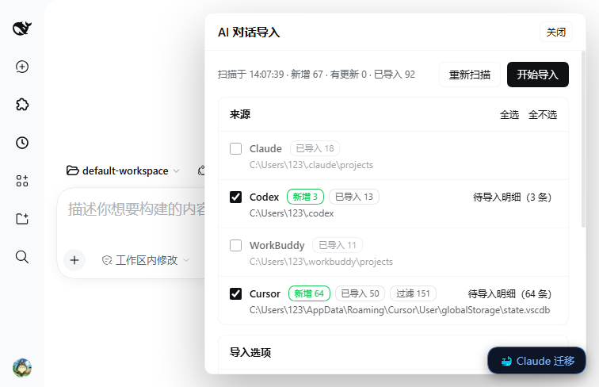
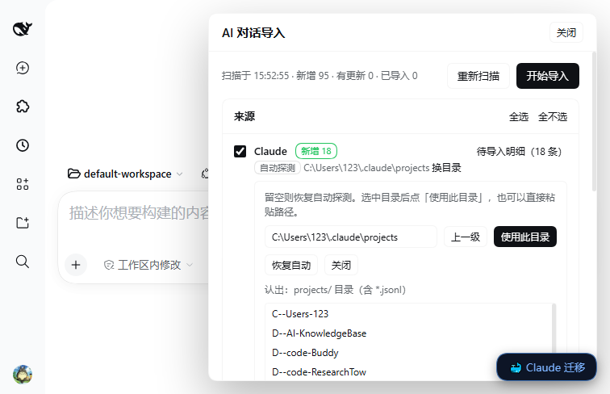

# dsh-ai-import

Import the conversation history of other AI coding assistants into DeepSeek Harness (DSH) as
**resumable sessions** — named after what was actually asked, and filed into one workspace per source.

Supported sources: **Claude Code**, **Codex CLI**, **WorkBuddy**, **Cursor**, and optionally **Trae**
(prompt-only). Two packages live in this repository:

| Package | Path | What it is |
| --- | --- | --- |
| `dsh-ai-import` | root | the converter: scanning, naming, session writing, grouping, the `/import-ai` command and two agent tools |
| `dsh-ai-import-ui` | `packages/ui` | the Web panel: a floating “AI 导入” button, a right-hand drawer, and a three-column pick-and-file wizard |

The panel drives the same `scanAll()` / `runImport()` code and the same ledger as the command, so the
two can be used interchangeably.



## Install

From this repository (works today — the packages are not on npm yet):

```sh
dsh plugin add github:LoneLeave/aiplug                     # the converter: command-line + agent tools
dsh plugin add "github:LoneLeave/aiplug&path:/packages/ui" # adds the Web panel on top of it
```

Once published to npm the same two lines become `dsh plugin add dsh-ai-import` and
`dsh plugin add dsh-ai-import-ui`.

Install both if you want the panel: `dsh-ai-import-ui` imports `dsh-ai-import/lib/*` directly and
does nothing useful without it. After installing, reload the DSH Web UI page.

Nothing in this plugin runs at install time — there is no build step, no `postinstall`, and no
dependency to compile. The packages ship plain ESM.

## Usage from an agent session

```
/import-ai                    scan and report how many conversations are importable
/import-ai full               list every entry (source, project, title, turns)
/import-ai run 5 --dry-run    convert 5 entries without writing anything
/import-ai run                import everything
/import-ai run cursor         import one source only
/import-ai run --force        re-import what the ledger already knows (new sessions, nothing overwritten)
/import-ai status             where the ledger lives, how much has been imported
```

The same capability is exposed as two tools:

- `ai_import_scan({ detail: "summary" | "full" })`
- `ai_import_run({ sources?, dryRun?, force?, limit? })`

## The Web panel

Click **AI 导入** in the bottom-right corner (it sits above the “🐳 Claude 迁移” button), or open
**Settings → AI 对话导入**. The drawer has two modes.

**Simple mode** — five source cards, each showing its resolved path (`手动指定` / `自动探测` /
`未找到`) and a one-line tally `新增 N · 已导入 M · 过滤 K`. Tick the sources you want, optionally
tick *dry run* / *force*, press **开始导入**, and watch a per-source progress bar and a result table.

**Pick mode (wizard)** — “上排三栏 + 下排整条预览”:

| Where | What | What you can do |
| --- | --- | --- |
| top left | every source with new or changed conversations (`Codex（3）`) | click one; the middle column lists its candidates |
| top middle | that source's candidates with checkboxes; for a folder, archived sessions (grey, not checkable) followed by each source's unimported candidates | tick what to import; click a row to preview it below |
| top right | every folder under `<DSH_HOME>/ai-import/groups` plus an input + **建立** / **归档到** / **取消归档指定** | create a folder, or point the current selection at an existing one |
| bottom, full width | the message stream of the selected conversation (question / answer / thinking / tool call) | decide whether this one is worth importing |

So “import three of these into an existing folder” is: click the folder, tick the conversations in
the middle column, press **归档到**, then **导入勾选的 N 条**.



## Naming

Titles come from, in order:

1. a title the source itself recorded — Claude's `custom-title` / `ai-title`, Codex's
   `session_index.jsonl` `thread_name`, a Cursor composer `name`;
2. the first line of the first human question, with injected noise stripped (`<system-reminder>`,
   `<user_info>`, `# AGENTS.md instructions`, `@skill:"…"`, Codex review templates), cut at the first
   sentence-final punctuation, at most 56 characters;
3. `<source> <date time>`;
4. `<source> conversation N`.

Two traps that are handled explicitly: Codex's `thread_name` contains repeated automation titles
(`Guardian review`, `Weekly review`, `hi`) — only names that appear exactly once in the whole index
are trusted; and an unnamed Cursor composer stores a UUID in `name`, which is treated as no name.

## Grouping

One workspace per source, not per project:

| Source | Directory | Workspace title |
| --- | --- | --- |
| Claude Code | `<DSH_HOME>/ai-import/groups/claude` | `Claude 对话` |
| Codex | `<DSH_HOME>/ai-import/groups/codex` | `Codex 对话` |
| WorkBuddy | `<DSH_HOME>/ai-import/groups/workbuddy` | `WorkBuddy 对话` |
| Cursor | `<DSH_HOME>/ai-import/groups/cursor` | `Cursor 对话` |
| Trae | `<DSH_HOME>/ai-import/groups/trae` | `Trae 对话` |

A session's own `cwd` still points at the real project directory, so opening it in DSH carries the
right project context; the group directory is used only when the original project is gone. The
wizard can also file individual conversations into any subdirectory of `groups/`, and the folder
name becomes the workspace title.

## Finding the sources on another machine

Every source resolves its root in this order: plugin `config` → the path remembered in the panel
(`<DSH_HOME>/ai-import/roots.json`) → environment variable → platform default. Windows, macOS and
Linux defaults are all covered, and the panel's **换目录** browser writes the remembered path, so a
machine with a non-standard install location works without editing any configuration file.

Trae is off by default (prompt-only data): enable it with `includePromptOnlySources: true`, or by
importing it from the pick-mode wizard where it appears when it has entries.

## What it writes

- Sessions go through DSH's own `sessionPersistence` service, in the same on-disk format DSH uses
  for its own sessions, after passing `validateSessionEvents`, so they can be resumed normally.
- Every session also gets a projection-cache record (`title` and `sessionListMetadata`), because
  DSH's session list reads cold sessions from that cache — without the record an imported session
  shows up as “未命名” (untitled) until it is opened once.
- The ledger is `<DSH_HOME>/ai-import/imports.json`: source key → session id, fingerprint, turns.
  Re-running only picks up new or changed files; a source file that grew appends to its session
  instead of creating a second one.
- Imported session ids look like `import-claude-<uuid>`, namespaced by source so they cannot collide
  with sessions imported by other tools.

Source files are only ever read. Nothing in the original assistant's directories is moved, renamed
or deleted.

## Requirements

- DSH `0.2.x` (the `engines.dsh` range in `package.json`).
- Node.js `^22.19.0 || >=24.9.0`.
- Official `@deepseek-ai/*` packages are declared as `peerDependencies`, not bundled.

## License

Apache-2.0. See [LICENSE](LICENSE). 中文说明见 [README.zh.md](README.zh.md).