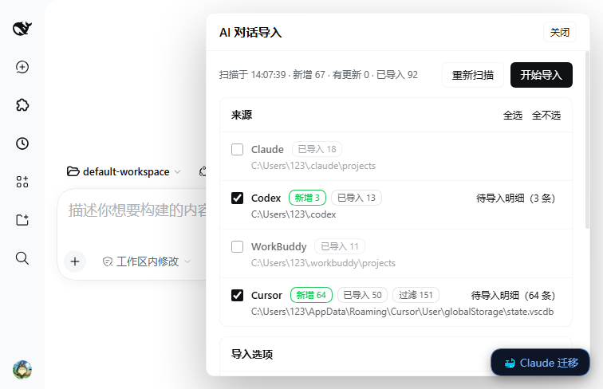
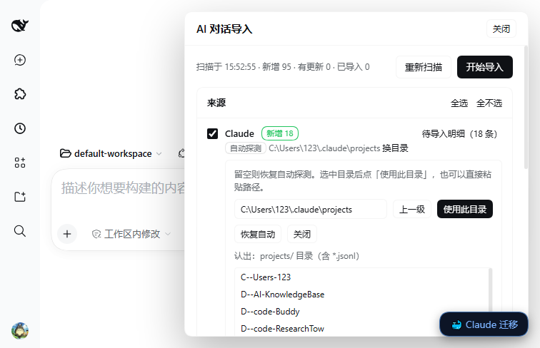

# dsh-ai-import-ui

The Web panel for [`dsh-ai-import`](../../). Two entry points, one implementation:

- **a floating “AI 导入” button in the bottom-right corner → a right-hand drawer** (the main entry,
  available on every page);
- **Settings → AI 对话导入** — the same component in a `compact` variant without the big heading.

From it you can scan the local AI-assistant histories (Claude Code / Codex / WorkBuddy / Cursor /
Trae), tick sources, watch per-source progress and read a result table — no command line needed.



```
┌ Host half: index.mjs ────────────────────────────┐
│ GET    /api/ai-import/index?refresh=1  scan      │
│ POST   /api/ai-import/import          start job  │
│ GET    /api/ai-import/progress?job=   progress   │
│ DELETE /api/ai-import/job?job=        cancel     │
│ GET    /api/ai-import/roots           roots      │
│ GET    /api/ai-import/browse?path=    browse dir │
│ POST   /api/ai-import/root            set root   │
│ GET    /api/ai-import/preview         preview    │
│ GET    /api/ai-import/folders         folders    │
│ POST   /api/ai-import/folder          make/rename│
└──────────────────────────────────────────────────┘
                    ↕ reuses
      dsh-ai-import/lib/runner.mjs   scanAll() / runImport() / previewEntry()
      dsh-ai-import/lib/roots.mjs    candidates() / browse() / remembered roots
┌ Client half: client.js ──────────────────────────┐
│ ctx.slots.register('shell.overlay',              │
│   { id:'ai-import', order:300 })  → overlay      │
│ ctx.slots.register('settings.section',           │
│   { id:'ai-import', order:230, label })          │
└──────────────────────────────────────────────────┘
```

Using it on a different machine relies on `roots.mjs`: each source looks at the plugin `config`
first, then the path remembered in `<DSH_HOME>/ai-import/roots.json`, then environment variables,
then the platform defaults (Windows / macOS / Linux candidates each). The panel's **换目录** browser
is what writes that file.

Both slots are registered through a `mount()` helper that wraps each registration in `try/catch`: a
failure in one leaves `[dsh-ai-import-ui] <label> 注册失败` in the console and does not take the
other slot — or the whole slot host — down with it.

## Why it is a separate package

`@deepseek-ai/dsh-client-modules` caches the verdict “this package is not a client package” per
Loader specifier until the **next start**. Adding `dsh.client` to an already-running plugin therefore
requires a host restart, while a newly installed package (a new Loader entry) is picked up
incrementally. So the panel ships on its own, and installing it needs only a page reload.

## Design constraints (read before changing)

- Both entry points are React components inside a slot — not an iframe, and nothing is appended to
  `document.body`.
- Do not `require` any `@deepseek-ai/dsh-client-*` package (an internal change would blank the whole
  slot); only `require('react')`.
- Colours come only from host tokens `--dsw-alias-*` (`bg-base`, `bg-layer-1`, `bg-layer-2`,
  `border-l1`, `border-l2`, `brand-primary`, `label-primary`, `label-secondary`,
  `state-success-primary`, `state-warn-primary`, `state-error-primary`), so light and dark themes
  follow automatically.
- Every class name starts with `aii-`.
- The overlay host container is already `position:absolute; inset:0; pointer-events:none` and only
  enables `pointer-events:auto` on **direct children**. So `.aii-layer` stays `none` and `.aii-fab` /
  `.aii-drawer` set `auto` — a closed drawer does not swallow clicks.
- `.aii-fab` uses `bottom: 74px` to make room for `dsh-claude-move`'s `#cm-open`
  (`right:16px; bottom:16px`). The two buttons were measured not to overlap (at a 756×488 viewport,
  y=376..414 vs y=437..472); measure again before moving it.

## Two import modes

The panel header switches between them.

- **Simple** (default): tick whole sources, then import. Everything at once, filed into
  `<source> 对话`.
- **Pick mode (wizard)**: a three-column top row with a full-width preview underneath, for
  “only these few, and into this folder”.

| Where | What | What you can do |
| --- | --- | --- |
| top left | every source with new or changed conversations (`<source>（N）`) | click one; the middle column lists its candidates |
| top middle | that source's candidates with checkboxes; for a folder, archived sessions (grey, no checkbox) followed by each source's unimported candidates | tick what to import; click a row to preview it below |
| top right | every folder under `ai-import/groups` plus an input + **建立** / **归档到** / **取消归档指定** | create a folder, or point the selection at an existing one |
| bottom, full width | the selected conversation's message stream (user / assistant / thinking / tool) | judge whether it is worth importing |



Switching to the wizard **widens the drawer** (`.aii-drawer--wide`,
`width: min(1040px, calc(100vw - 32px))`, measured 726px) through a module-level mode subscription
(`MODE_LISTENERS` / `setGlobalMode` / `useGlobalMode`) that hands the page's `mode` to the overlay;
switching back restores 480px. The wizard's “导入选项” row (dry run / force / per-source limit) is the
same `dryRun` / `force` / `limit` state as the simple mode, passed down as page props.

Two deliberate behaviours, both easy to “fix” wrongly:

- **建立 does not jump to the new folder** — it is still empty, and jumping there would hide the
  conversations you just ticked.
- **归档到 does not switch the view either** — the folder list is always in the right column, and the
  middle column already lists both archived and pending rows; the assigned rows get a “归入「X」” tag
  instead.

Also: in `doImport()` the `source` of each pick must be taken from the **key prefix**
(`key.slice(0, key.indexOf(':'))`), not from the currently selected source — otherwise a selection
spanning several sources is silently dropped by the Host's per-source filter.

## First-run guide

The first time the panel opens, a four-step card explains what the panel does, how to confirm the
sources it found, how to choose between the two modes, and what happens after an import. “下一步”
pages through it; “不再显示” remembers the choice in
`localStorage['dsh-ai-import-ui.guide.seen']`. The header's **使用指引** button reopens it at step 1
at any time. When `localStorage` is unavailable the card appears once per session instead.

## Install and how changes take effect

```sh
dsh plugin add dsh-ai-import-ui
```

Then reload the Web UI page.

- `index.mjs` (the host half) is reloaded by toggling the bundle off and on again — no app restart.
- `client.js` is re-read by `dsh-client-hmr`, which polls every 500 ms and calls
  `clientModules.rebuilt(id)`; a page refresh is enough.
- Verifying that the browser really got new bytes: the boot HTML preloads modules **as one group**
  (`<link rel="preload" href="plugins/??A,B,C&rev=<hex>">`), and the `rev` is shared by that group.
  Fetching `/plugins/??dsh-ai-import-ui/client.js&rev=<group rev>` returns 404 — copy the whole
  preload `href` (with every module in the group) and fetch that instead.

## Screenshots

`assets/screenshot-1.png` (simple drawer), `assets/screenshot-2.png` (pick mode),
`assets/screenshot-3.png` (folder browser), listed in `screenshots.json` next to `package.json`.

## License

Apache-2.0. 中文说明见 [README.zh.md](README.zh.md).